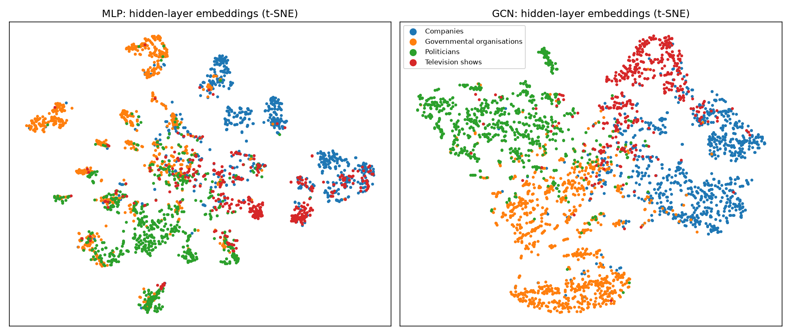
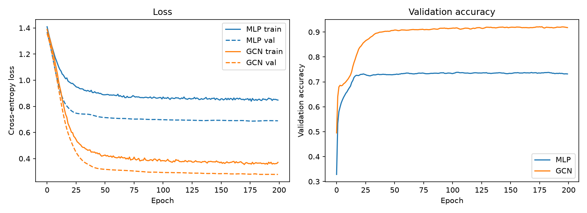
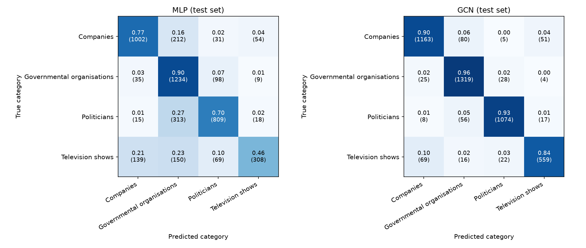
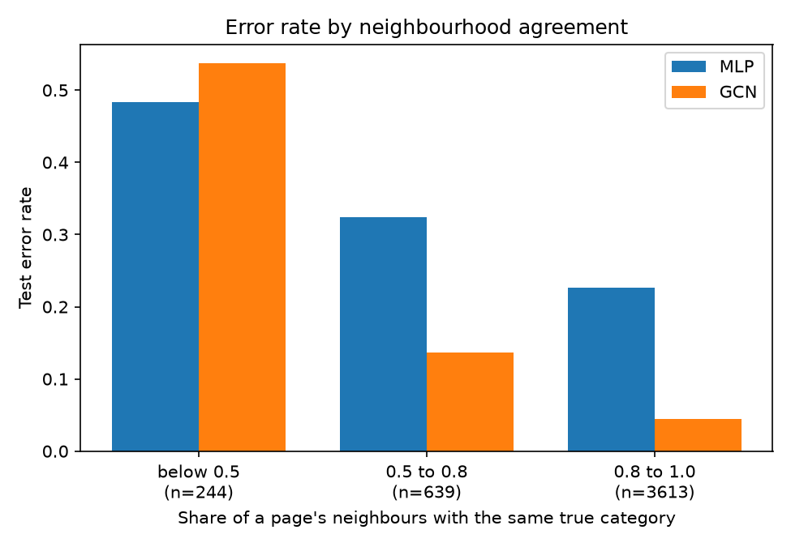

# Node Classification of Facebook Pages with a Graph Convolutional Network

## Overview

**The problem.** The data is a network of 22,470 verified Facebook pages, where two pages are linked if they like each other and each page has a 128-dimensional feature vector built from its description. The task is to classify each page into one of four categories: companies, governmental organisations, politicians or television shows. It is semi-supervised and transductive: the whole graph is visible during training, but only the labels of training pages are used. The setting is an automatic page-categorisation tool for a web platform, where confident predictions are automated and uncertain ones go to a human reviewer, so the project asks how accurate the classifier is and also whether its confidence can be trusted to decide what to automate.

**How it works.** The model is a 2-layer graph convolutional network (GCN) [2]. Each layer replaces a page's features with a weighted average over itself and its linked pages, followed by a learned transformation and a ReLU:

$$H^{(l+1)} = \mathrm{ReLU}\left(\hat{A}\,H^{(l)}\,W^{(l)}\right), \qquad \hat{A} = D^{-1/2}(A + I)D^{-1/2}$$

This should help because linked pages tend to share a category (88.5% of links in this graph join pages of the same category). Adding self-loops lets each page keep its own features, and the symmetric normalisation stops pages with many links from dominating. Two layers means each page sees its neighbours and their neighbours, which keeps the model shallow and avoids over-smoothing, and dropout limits overfitting. The final layer outputs a probability for each category, and the highest probability is the model's confidence. A reject rule sends any page below a confidence threshold, chosen on validation data, to a human. The GCN is compared against an MLP baseline of the same size that uses each page's own features and ignores the links, trained and evaluated on identical splits.

On the held-out test pages (mean of three runs), the GCN reaches 0.913 accuracy and 0.907 macro-F1, against 0.742 and 0.718 for the MLP. At about 95% accuracy on automated predictions, it can automate about 91% of pages, against 47% for the MLP. The remaining errors include confident ones in neighbourhoods that agree with each other but belong to another category, which the confidence threshold cannot catch (see Failure Case Analysis).



*t-SNE of the last hidden layer for 3,000 random test pages (seed 0), coloured by true category; MLP on the left, GCN on the right. The GCN's embeddings form broad, mostly single-category regions, while the MLP's are fragmented and mixed. Each panel is a separate t-SNE run, so positions and distances are not comparable across panels, and the legend applies to both.*

---

## Feasibility Review

### 1. User Need, Scope & Acceptance Criteria

A possible user for this model can be a web platform or data research team that needs to categorise Facebook pages automatically, with low-confidence predictions routed to a human reviewer. The project involves a semi-supervised, 4-class node classification on the Facebook Page-Page graph, comparing a multi-layer GNN with an MLP baseline on identical splits.

**Acceptance criteria:**

| # | Criterion | Measured on |
|---|-----------|-------------|
| 1 | GNN macro-F1 is at least 0.05 above the MLP's | Test split |
| 2 | Mean softmax confidence on correct predictions exceeds that on incorrect ones by at least 0.25, and confidence detects errors with AUROC of at least 0.85 | Test split |
| 3 | A threshold chosen on the validation set gives at least 95% test accuracy above it while covering at least 60% of nodes while the rest go to human review | Test split |
| 4 | Training takes under 5 minutes and peak GPU memory stays under 2 GB (provisional) | One GPU |

### 2. Model Choice & Course Concepts

The data is the Facebook Large Page-Page Network, which has 22,470 pages with mutual-like edges. Each page has 128-dimensional features and are one of four categories. The task is transductive, which means that the whole graph is visible in training, but test labels are not used. Nodes are split 60/20/20 (train, validation, test), stratified by class with a fixed seed. Validation data is used for model selection and the threshold, and the test data is used for final reporting.
The model is a 2-layer GCN1 with hidden size 64 and dropout 0.5 implemented with PyTorch (Normal difficulty). The baseline is an MLP of the same size using node features only.
Each GCN layer averages a node's features with its neighbours', which should help because linked pages tend to share a category. The normalised adjacency with self-loops keeps a node's own features and stops high-degree pages dominating. Shallow depth avoids over-smoothing, and dropout limits overfitting. Softmax probability is the confidence signal for the reject rule.

### 3. Preliminary Feasibility Evidence

**Data audit:** 22,470 nodes, 128 features, 4 classes (28.9%, 30.6%, 25.7%, 14.8%). No isolated nodes, mean degree 15.2, and edge homophily 0.885.

**MLP baseline** (2 layers, 100 epochs, 60/20/20 random split):

| Metric | Value |
|--------|-------|
| Test accuracy | 0.793 |
| Test macro-F1 | 0.774 |
| Mean confidence (correct / wrong) | 0.816 / 0.556 |
| Error-detection AUROC | 0.823 |
| Threshold 0.8 (chosen on validation) | 95.2% test accuracy on the 51% of nodes retained |

**GPU use (MLP, one A100):** 3.4 s for 100 epochs (0.034 s/epoch), peak memory 49.8 MB.

The pipeline loads, trains and evaluates end to end, with headroom for a GNN to improve on the baseline.

### 4. Risks, Budget & Fallback

The risks for the GNN implementation include (1) Label leakage through the graph. (2) The GNN failing to beat the MLP or being more overconfident. (3) Class imbalance (stratified splits, macro-F1). (4) Over-smoothing (which is why we will use only 2-3 layers). (5) Limited GPU access.
As for the budget, the MLP trains in 3.4 s with 49.8 MB peak GPU memory, so the GCN is expected to need no more than a couple of minutes per run and well under 500 MB. Several jobs on one GPU and the job’s peak memory and timing will be measured.
Next task is to Implement the GCN, train it with the MLP's loop and split, and compare macro-F1, confidence gap, AUROC and the reject rule.
If the GCN does not improve on the MLP, that will be reported and analysed (for example, accuracy on high- versus low-homophily nodes).

---

## Setup and Usage

### Dependencies

| Package | Version |
|---------|---------|
| Python | 3.11.15 |
| PyTorch | 2.13.0+cu130 |
| NumPy | 2.4.6 |
| scikit-learn | 1.9.1 |
| matplotlib | 3.11.1 |

Experiments were run on a single NVIDIA A100 (Rangpur) with the `torch` conda environment.

### Data

The Facebook Page-Page graph is read from `facebook.npz`, which was supplied by the
course coordinators because the original download host was unavailable. Place it at
`recognition/GNN_s49621093/data/FacebookPagePage/raw/facebook.npz`. The `data/`
folder is git-ignored, so the file is not part of the repository.

### Reproducibility

Splits and model initialisation are seeded. The results use seeds 0, 1 and 2 (the
default is 0). Results can differ slightly between CPU and GPU runs.

### Running

Run everything from `recognition/GNN_s49621093/`, after placing `facebook.npz` as
described under Data. The scripts run in this order:

```bash
# 1. Train the MLP baseline and the GCN, and save weights, curves and metrics.
#    Results in the report use seeds 0, 1 and 2 (--seed sets the model
#    initialisation and --split-seed sets the train/validation/test split).
python train.py --seed 0 --split-seed 0 --out outputs/seed0
python train.py --seed 1 --split-seed 1 --out outputs/seed1
python train.py --seed 2 --split-seed 2 --out outputs/seed2

# 2. Average the results over the three runs (mean ± standard deviation).
python aggregate.py "outputs/seed*"

# 3. Load the trained seed-0 models, then draw the confusion matrices,
#    t-SNE plot and error-rate figure, and write the failure cases.
python predict.py --run-dir outputs/seed0
```

| Script | What it does | Output |
|---|---|---|
| `train.py` | Trains both models, picks the best epoch on validation accuracy, evaluates on the test split | `outputs/seed*/` containing `MLP.pt`, `GCN.pt`, `results.json`, `training_curves.png` |
| `aggregate.py` | Reads each `results.json` and prints the comparison tables | Markdown tables on screen |
| `predict.py` | Loads saved weights, re-evaluates on the test split, makes figures and the failure-case analysis | `figures/*.png` and `outputs/failure_cases.md` |

`train.py` takes a few seconds on a GPU. The weights (`*.pt`) and the `outputs/`
folder are git-ignored, so run `train.py` before `predict.py`.

---

## Data and Preprocessing

Dataset details are in the Feasibility Review (part 2). The data is read directly from `facebook.npz`.

**Graph preprocessing:** Edges are treated as undirected, and the adjacency matrix is symmetrically normalised with self-loops (Kipf and Welling [2]):

$$\hat{A} = D^{-1/2}(A + I)D^{-1/2}$$

**Splits:** Nodes are split 60% train, 20% validation and 20% test, stratified by class so that each split has the same class proportions as the whole graph.

**Leakage prevention:** The setting is transductive, so the full graph is visible during training, but only the labels of training nodes enter the loss.

---

## Results

All results are mean ± standard deviation over 3 runs (seeds 0-2, which vary
both the model initialisation and the train/validation/test split). Both models
have 8,516 parameters, use the same splits and the same training setup (Adam,
learning rate 0.01, weight decay 5e-4, dropout 0.5, 200 epochs, best epoch
chosen on validation accuracy).

The MLP scores lower here than in the preliminary smoke test in the Feasibility Review (0.793 accuracy), which used a plain random split and dropout on the hidden layer only. The final models use the stratified split and apply dropout to the input features as well.

### GCN vs MLP Baseline

| Metric | MLP | GCN |
|---|---|---|
| Test accuracy | 0.742 ± 0.005 | 0.913 ± 0.005 |
| Test macro-F1 | 0.718 ± 0.004 | 0.907 ± 0.004 |
| Class AUROC (one-vs-rest) | 0.929 ± 0.003 | 0.985 ± 0.001 |

Per-class precision and recall (classes are indexed 0-3 as in the dataset
label. Class 3 is the smallest class, about 15% of pages):

| Class | MLP precision | MLP recall | GCN precision | GCN recall |
|---|---|---|---|---|
| Class 0: Companies | 0.831 ± 0.012 | 0.778 ± 0.008 | 0.917 ± 0.002 | 0.902 ± 0.006 |
| Class 1: Governmental Organisations | 0.640 ± 0.007 | 0.892 ± 0.012 | 0.894 ± 0.009 | 0.947 ± 0.010 |
| Class 2: Politicians | 0.799 ± 0.013 | 0.689 ± 0.021 | 0.942 ± 0.008 | 0.928 ± 0.014 |
| Class 3: Television Shows | 0.827 ± 0.041 | 0.452 ± 0.021 | 0.893 ± 0.010 | 0.834 ± 0.005 |

The GCN improves macro-F1 by 0.187, 0.187 and 0.192 in the three runs, about
40 times the run-to-run spread, so the gain is not down to seed luck. It
improves every class on both precision and recall. The largest gain is recall
on television shows, the smallest class: the MLP finds fewer than half of them
(0.452) while the GCN finds 83%. The MLP's low precision on governmental
organisations (0.640) alongside its high recall (0.892) suggests it assigns
pages from other categories to that class when unsure.



*Training curves (seed 0). Both models converge by about epoch 75 with no sign
of overfitting. Training loss is higher than validation loss because dropout is
active during training and off during evaluation.*

### Confidence and Reject-Option Analysis

| Metric | MLP | GCN |
|---|---|---|
| Mean confidence, correct predictions | 0.699 ± 0.003 | 0.885 ± 0.001 |
| Mean confidence, wrong predictions | 0.452 ± 0.001 | 0.626 ± 0.001 |
| Confidence gap | 0.246 ± 0.004 | 0.259 ± 0.002 |
| Error-detection AUROC | 0.843 ± 0.004 | 0.852 ± 0.002 |
| Expected calibration error (ECE) | 0.108 ± 0.000 | 0.050 ± 0.005 |
| Reject rule: test accuracy above threshold | 0.950 ± 0.004 | 0.947 ± 0.003 |
| Reject rule: test coverage | 0.467 ± 0.007 | 0.906 ± 0.015 |

The reject-rule threshold is the lowest confidence whose validation accuracy
reaches 95%, chosen on the validation set. Accuracy and coverage above it are
then measured on the test set.

In both models, confidence is a useful signal for errors (error-detection AUROC
0.84-0.85, well above the 0.5 of chance). The GCN is only slightly better at
flagging its own mistakes (gap 0.259 vs 0.246) and is more confident when it is
wrong (0.626 vs 0.452), but it is better calibrated (ECE 0.050 vs 0.108). The
practical benefit is coverage: at about the same 95% accuracy, the GCN can
automate about 91% of pages, against 47% for the MLP.

### Resource Profile

| Metric | MLP | GCN |
|---|---|---|
| Parameters | 8,516 | 8,516 |
| Training time, 200 epochs (s) | 0.7 | 0.7-0.8 |
| Inference, one pass over the graph (ms) | 0.173 ± 0.008 | 0.422 ± 0.004 |
| Peak GPU memory (MB) | 74.6 | 97.2 |

Measured on a single NVIDIA A100 on Rangpur. Both models are far inside the
acceptance limits (5 minutes, 2 GB). The GCN needs about 2.4 times the
inference time and 23 MB more memory.

### Acceptance Criteria Outcome

| # | Criterion | Result | Outcome |
|---|---|---|---|
| 1 | GCN macro-F1 at least 0.05 above the MLP's | +0.187 to +0.192 | Met |
| 2 | Confidence gap at least 0.25 and error AUROC at least 0.85 | 0.259 and 0.852 | Met, narrowly |
| 3 | At least 95% test accuracy above the threshold, with at least 60% coverage | 0.947 accuracy, 0.906 coverage | Coverage met, accuracy narrowly missed |
| 4 | Under 5 minutes and under 2 GB | about 1 s, 97 MB | Met |

Criterion 3 narrowly misses on accuracy (0.947 vs 0.95) because the threshold
is chosen to reach 95% on the validation set, and accuracy drops slightly on
unseen test data.

### Error Analysis: Confusion Matrices



*Row-normalised confusion matrices on the test set (seed 0), with counts in
brackets. Each row shows where the pages of one true category were predicted.*

The MLP's low precision on governmental organisations (0.640) comes from
pages of other categories being assigned to it: of its 1,909 governmental
predictions, 313 were politicians, 212 were companies and 150 were television
shows. The GCN reduces the politicians-to-governmental errors from 313 to 56.
Television shows are the hardest class for the MLP, which finds 46% of them,
against 84% for the GCN. The GCN's remaining errors are small and spread out:
companies predicted as governmental organisations (80), television shows
predicted as companies (69), and politicians predicted as governmental
organisations (56). Politicians and governmental organisations overlap in
practice (some politicians' pages are labelled governmental), so some of these
errors reflect ambiguous categories as well as model mistakes.

### Embedding Visualisation


*t-SNE of the last hidden layer for 3,000 random test pages (seed 0), coloured
by true category. Each panel is a separate t-SNE run, so positions and
distances are not comparable across panels.*

The MLP's embeddings form many small, fragmented groups with a mixed region in
the middle. The GCN's form broader regions that are mostly one category each,
with overlap along the boundaries between categories, such as governmental
organisations and politicians, which agrees with the confusion matrix.
t-SNE preserves local neighbourhoods but not global distances, so this is a
qualitative picture and not a measurement.

### Failure Case Analysis

The GCN made 381 errors on the 4,496 test pages (seed 0). The five cases below
were chosen automatically, one for each failure type, taking the most extreme
example of each type (for example the most confident error), so they illustrate
failure modes and are not a random sample. Neighbour categories are the true
labels of linked pages and are used for analysis only, never for training or
prediction.

| Failure type | Page | True category | GCN prediction (confidence) | MLP prediction (confidence) | Links | True categories of neighbours | Sent to a human? |
|---|---|---|---|---|---|---|---|
| Confident error | Senate of Canada - Sénat du Canada | Governmental organisations | Politicians (1.00) | Governmental organisations (0.45) | 266 | Politicians 265, Governmental 1 | No |
| Misled by neighbours | Crossroads Hospice | Companies | Governmental organisations (0.92) | Governmental organisations (0.84) | 9 | Governmental 9 | No |
| Low-degree page | Fractal | Television shows | Companies (1.00) | Companies (0.83) | 1 | Companies 1 | No |
| Uncertain error | Rocío Giaccone | Politicians | Governmental organisations (0.55) | Governmental organisations (0.52) | 2 | Governmental 1, Politicians 1 | Yes |
| Graph hurt | Harish Rawat | Politicians | Governmental organisations (1.00) | Politicians (0.81) | 44 | Governmental 42, Companies 1, Politicians 1 | No |

**Reading the cases.**
- *Senate of Canada* has 265 politician neighbours and one governmental neighbour. The GCN is certain it is a politician. The MLP, using only the page's own features, was right but unsure. A governmental body linked almost entirely from politicians' pages is a case where the graph misleads, and one that a confidence threshold cannot catch.
- *Crossroads Hospice* has nine neighbours, all governmental organisations. The MLP also predicted governmental organisations (0.84), so the neighbourhood reinforced an error already suggested by the page's own features. The boundary between companies and governmental organisations looks blurry for pages like this one, and the label may be ambiguous.
- *Fractal* has a single link, to a company. With so little neighbourhood, one neighbour has a large influence on the result, and both models were confident and wrong.
- *Rocío Giaccone* is the rule working as intended: two links with mixed neighbours gave a confidence just under the 0.55 threshold, so the page goes to a human.
- *Harish Rawat* is a case where the graph hurt: the MLP was correct, but 42 of 44 neighbours are governmental organisations, and the GCN followed them with full confidence.

**Error rate by neighbourhood agreement** (test set, seed 0. The share of a page's neighbours with the same true category):

| Share of neighbours with the same category | Test pages | MLP error rate | GCN error rate |
|---|---|---|---|
| Below 0.5 | 244 (5%) | 0.484 | 0.537 |
| 0.5 to 0.8 | 639 (14%) | 0.324 | 0.136 |
| 0.8 to 1.0 | 3,613 (80%) | 0.226 | 0.045 |

**Error rate by number of links** (self-links excluded):

| Links | Test pages | MLP error rate | GCN error rate |
|---|---|---|---|
| 1 to 3 | 1,389 (31%) | 0.281 | 0.123 |
| 4 to 10 | 1,396 (31%) | 0.287 | 0.088 |
| 11 or more | 1,711 (38%) | 0.206 | 0.051 |



**Findings.** The GCN's advantage comes from pages whose neighbourhood agrees
with their category (80% of pages, error rate 0.045 against 0.226 for the MLP).
Pages whose neighbours mostly belong to other categories are only 5% of the test
set but account for about a third of the GCN's errors, and there the GCN is no
better than the MLP (0.537 against 0.484, with 244 pages this difference is
within chance). The GCN beats the MLP at every link count, but pages with few
links remain the hardest. Three of the five cases were confident errors
(confidence 0.92 to 1.00): when a neighbourhood is consistent but belongs to a
different category, the GCN is confidently wrong, which also explains its
higher mean confidence on wrong predictions (0.626 against 0.452). A
confidence threshold cannot catch these. These tables are from a single run
(seed 0).

### Recommendation

Use the GCN in preference to the MLP. At about the same 95% accuracy on
automated predictions, it can automate about 91% of pages against 47% for the
MLP, and it improves macro-F1 by about 0.19. The extra cost is small: about 23 MB
more GPU memory and 0.25 ms more per inference pass, well inside the acceptance
limits.

Set the confidence threshold on validation data (0.55 for seed 0), and route
everything below it to a human reviewer. This met the coverage target
comfortably but narrowly missed the 95% accuracy target on test data (0.947).
If 95% is required, choose the threshold with a stricter validation target and
accept lower coverage.

The automated predictions should not be treated as fully trustworthy. Confident errors in
consistent-but-mislabelled neighbourhoods get through the confidence rule, so
a sample of automated predictions should still be audited by a human, and pages with
few links deserve extra attention. An untested idea is to also flag pages where
the GCN and the MLP disagree, which would have caught two of the five cases
above.

---

## Artificial Intelligence Usage Disclosure

I used Claude Sonnet 5.5 to explain concepts and to help write and verify technical parts of the code in dataset.py, modules.py, train.py, and predict.py that used libraries which I was not familiar with, including parts of the code that needed knowledge that were not taught in lectures / needed as prerequisite for the course. I verified its output through my own research and by running jobs on rangpur to test whether its output matched with expected output.

## References

1. B. Rozemberczki, C. Allen and R. Sarkar, "Multi-scale attributed node embedding," *Journal of Complex Networks*, vol. 9, no. 2, 2021.
2. T. N. Kipf and M. Welling, "Semi-supervised classification with graph convolutional networks," in *Proc. ICLR*, 2017.
